# Smart CV Maker

Ứng dụng tạo CV chuyên nghiệp cho sinh viên, fresher và người đi làm. Chạy trên
**Android**, **iOS** và **Web** (có giao diện riêng cho máy tính). Dữ liệu được
lưu trên máy trước nên vẫn dùng được khi mất mạng; khi đăng nhập, CV được sao
lưu lên tài khoản và đồng bộ giữa các thiết bị.

<p align="center">
  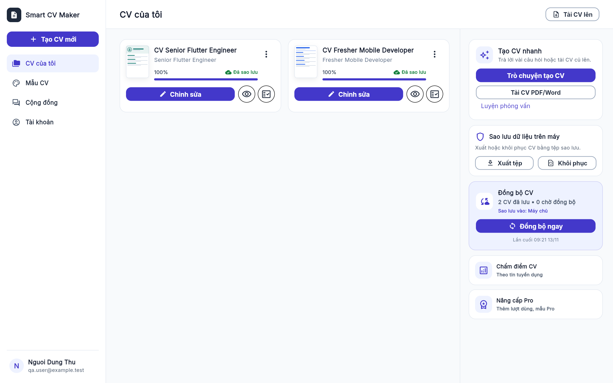
</p>

<p align="center">
  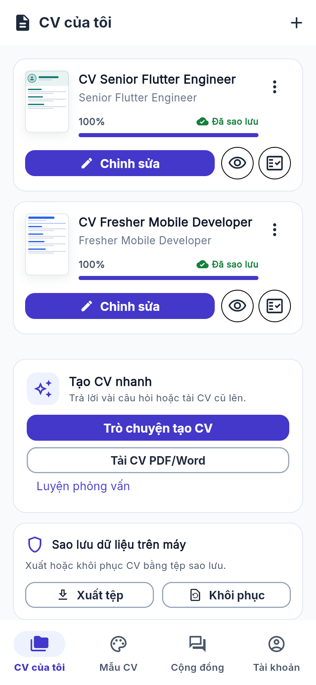
  &nbsp;
  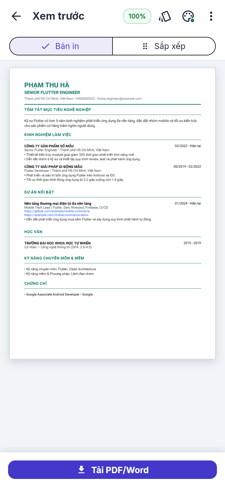
  &nbsp;
  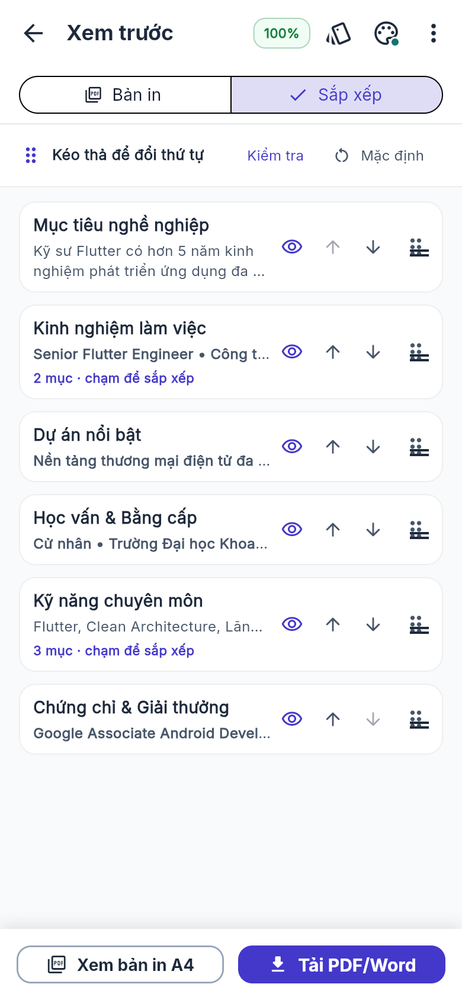
</p>

---

## Mục lục

- [Hướng dẫn tạo CV từng bước](#hướng-dẫn-tạo-cv-từng-bước)
- [Tính năng chính](#tính-năng-chính)
- [Giao diện trên máy tính](#giao-diện-trên-máy-tính)
- [Công nghệ](#công-nghệ)
- [Cài đặt và chạy](#cài-đặt-và-chạy)
- [Deploy bản web](#deploy-bản-web)
- [Kiểm thử](#kiểm-thử)
- [Tài liệu](#tài-liệu)

---

## Hướng dẫn tạo CV từng bước

### Bước 1. Đăng nhập hoặc dùng thử

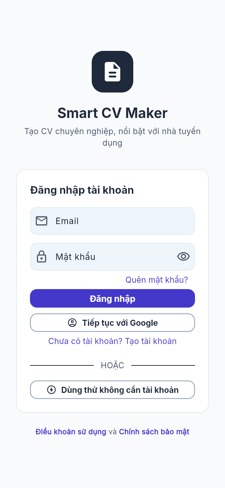

- **Đăng nhập** bằng email/mật khẩu hoặc Google để CV được sao lưu vào tài khoản.
- Chưa có tài khoản: bấm **Tạo tài khoản**.
- Muốn thử nhanh: bấm **Dùng thử không cần tài khoản** — CV vẫn lưu trên máy,
  sau này đăng nhập sẽ được hỏi để sao lưu.

<br clear="right">

### Bước 2. Tạo CV mới và chọn mẫu

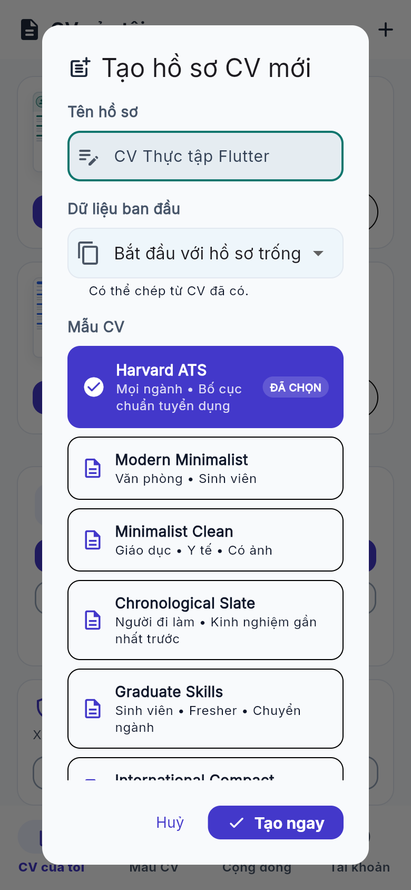

1. Ở trang **CV của tôi**, bấm dấu **+** (trên máy tính: nút **Tạo CV mới** ở thanh bên).
2. Đặt **tên hồ sơ**, ví dụ "CV Thực tập Flutter".
3. Chọn **Dữ liệu ban đầu**: hồ sơ trống hoặc chép từ CV đã có.
4. Chọn **mẫu CV** rồi bấm **Tạo ngay**.

Tài khoản Free dùng 6 mẫu; gói Pro mở thêm 11 mẫu.

<br clear="right">

### Bước 3. Điền thông tin

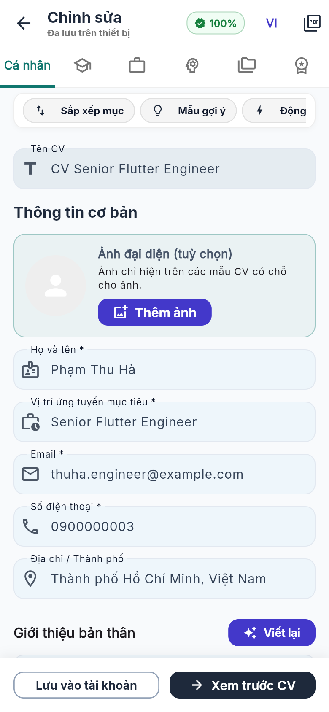

- Các thẻ phía trên: **Cá nhân, Học vấn, Kinh nghiệm, Kỹ năng, Dự án, Chứng chỉ**.
- Thanh công cụ: **Mẫu gợi ý** (điền nhanh câu mẫu), **Động từ mạnh**, cỡ chữ,
  **Màu CV**, in đậm, gạch đầu dòng, chèn link.
- Nút **Viết lại** giúp chỉnh câu giới thiệu cho gọn và chuyên nghiệp hơn.
- Huy hiệu **%** ở góc trên cho biết CV đã đầy đủ bao nhiêu; bấm vào để xem còn thiếu gì.
- CV tự lưu trên máy khi gõ; bấm **Lưu vào tài khoản** để sao lưu.

<br clear="right">

### Bước 4. Xem trước bản in


- Bấm **Xem trước CV** để thấy đúng trang A4 sẽ in ra.
- Thanh trên cùng: đổi **mẫu**, đổi **màu**, và menu **⋮** với: so khớp tin tuyển
  dụng, chỉnh cỡ chữ cho vừa 1 trang, chuyển CV sang tiếng Anh, xem bản in đen trắng.

<br clear="right">

### Bước 5. Sắp xếp các mục


- Chuyển sang thẻ **Sắp xếp**.
- Kéo thả (hoặc dùng mũi tên) để đổi thứ tự các mục.
- Bấm biểu tượng **con mắt** để ẩn/hiện một mục trên bản in.
- Chạm vào một mục có nhiều dòng (Kinh nghiệm, Kỹ năng…) để sắp xếp từng dòng bên trong.

<br clear="right">

### Bước 6. Tải CV về máy

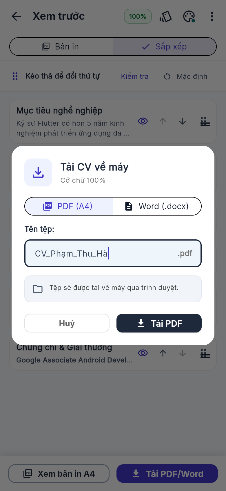

- Bấm **Tải PDF/Word**.
- Chọn **PDF (A4)** để gửi nhà tuyển dụng, hoặc **Word (.docx)** để sửa tiếp trên
  Word/Google Docs.
- Đặt tên tệp rồi bấm **Tải PDF**.

<br clear="right">

> Mẹo: có thể bỏ qua bước 2–3 bằng **Tạo CV nhanh** — trả lời vài câu hỏi trong
> **Trò chuyện tạo CV**, hoặc **Tải CV PDF/Word** cũ lên để ứng dụng tự điền.

---

## Tính năng chính

**Tạo và chỉnh sửa CV**
- 17 mẫu CV (6 miễn phí, 11 gói Pro), 8 màu chủ đạo, chỉnh cỡ chữ 75–140%.
- Gợi ý câu mẫu, thư viện kỹ năng theo ngành, danh sách động từ mạnh.
- Kiểm tra chất lượng CV: thiếu thông tin, email sai, câu quá dài/ngắn, thiếu số liệu.
- Xuất **PDF A4** sắc nét (đủ dấu tiếng Việt) và **Word (.docx)**, chạy ngay trên máy.

**Trợ giúp tìm việc**
- **So khớp tin tuyển dụng**: dán link hoặc nội dung tin, xem % phù hợp và thêm kỹ năng còn thiếu.
- **Trò chuyện tạo CV**, **tải CV cũ lên để tự điền**, **viết lại** câu giới thiệu
  và kinh nghiệm, **thư xin việc** theo tin tuyển dụng.
- **Luyện phỏng vấn** dựa trên CV, có nhận xét cho từng câu trả lời.
- Tài khoản Free 15 lượt/ngày, Pro 200 lượt/ngày.

**Tài khoản và dữ liệu**
- Đăng nhập email/mật khẩu hoặc Google; quên mật khẩu qua email.
- Lưu trên máy trước, đồng bộ khi có mạng; tự sao lưu CV của chế độ dùng thử sau khi đăng nhập.
- Xuất/khôi phục tệp sao lưu; hai máy chủ Supabase dự phòng cho nhau.

**Cộng đồng**
- Thảo luận, chia sẻ việc làm, nhờ góp ý CV; tìm kiếm và lọc theo loại bài.
- Bài mới, lượt thích và bình luận **cập nhật tức thời** không cần tải lại.
- Báo cáo bài vi phạm, giới hạn tần suất đăng để chống spam.

**Gói Pro**
- Thanh toán chuyển khoản qua mã VietQR; quản trị viên duyệt yêu cầu nâng cấp.

---

## Giao diện trên máy tính

Bản web trên máy tính có bố cục riêng: thanh điều hướng bên trái, tiêu đề trang
cố định và nội dung chia cột.

<table>
  <tr>
    <td align="center">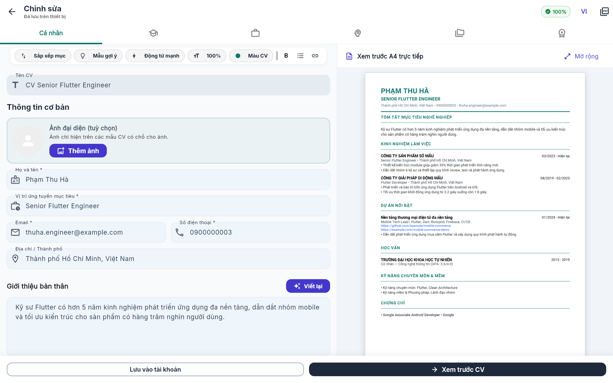<br>Chỉnh sửa với bản xem trước A4 song song</td>
    <td align="center">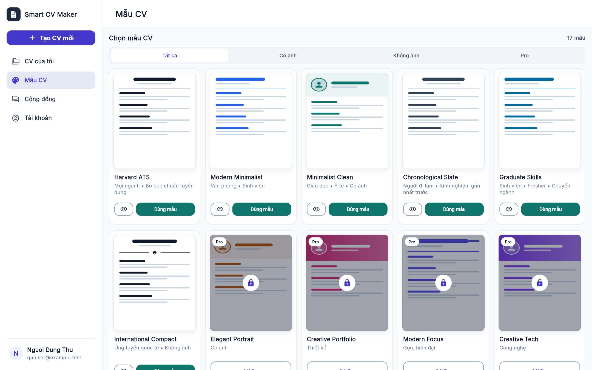<br>Thư viện mẫu CV (mẫu Pro có khóa)</td>
  </tr>
  <tr>
    <td align="center" colspan="2">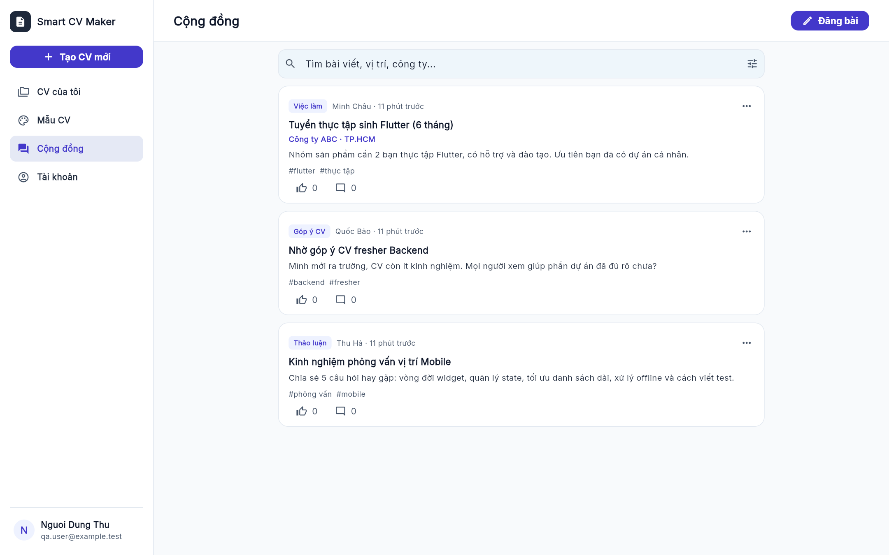<br>Cộng đồng việc làm</td>
  </tr>
</table>

---

## Công nghệ

| Phần | Công nghệ |
| --- | --- |
| Ứng dụng | Flutter 3 / Dart 3, Riverpod, GoRouter |
| Lưu trên máy | Drift (SQLite), SQLite WASM + IndexedDB trên web |
| Backend | Supabase: PostgreSQL + Row Level Security, Auth (email, Google), Realtime |
| Xử lý phía máy chủ | Supabase Edge Functions (TypeScript/Deno) gọi mô hình AI qua OpenRouter, giới hạn lượt dùng theo gói |
| Tài liệu | `pdf`/`printing` cho PDF A4, OpenXML (`archive`) cho Word |
| Hosting web | Vercel, tự deploy khi nhánh `main` có code mới |

Khóa AI chỉ nằm trong Supabase Function Secrets, không có trong ứng dụng.
Mọi bảng dữ liệu người dùng đều bật RLS: mỗi người chỉ đọc/ghi được dữ liệu của mình.

Cấu trúc mã nguồn theo Clean Architecture, chia theo tính năng:

```text
lib/
├── app/            # Theme, router, cấu hình ứng dụng
├── core/           # Database (Drift), Supabase, tiện ích dùng chung
└── features/
    ├── auth/           # Đăng nhập, đăng ký, tài khoản
    ├── cv_management/  # Trang chính, thư viện mẫu, đồng bộ, giao diện máy tính
    ├── cv_editor/      # Trình chỉnh sửa và công cụ viết CV
    ├── cv_preview/     # Xem trước, sắp xếp, xuất PDF/Word
    ├── cv_backup/      # Sao lưu và khôi phục
    ├── resume_import/  # Nhập CV từ PDF/Word
    ├── ai_tools/       # Trò chuyện tạo CV, chấm điểm, luyện phỏng vấn
    ├── community/      # Cộng đồng
    ├── billing/        # Gói Pro
    └── legal/          # Điều khoản, chính sách bảo mật
```

Mỗi tính năng có 3 tầng: `domain/` (model, interface), `data/` (SQLite,
Supabase, repository), `presentation/` (màn hình, widget, controller).

---
